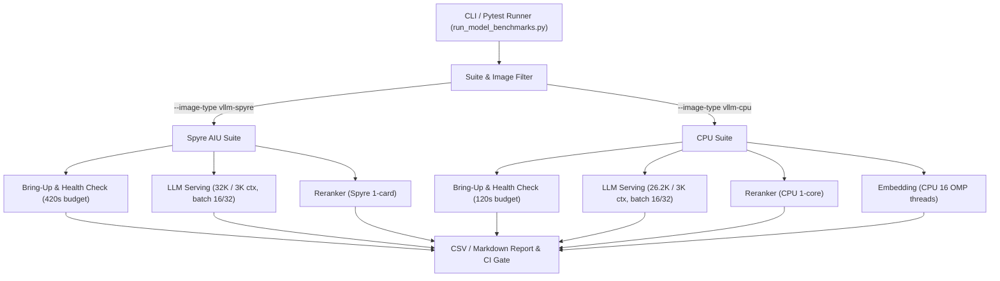

# Acceptance Testing and Performance Benchmarking Plan: Embedding, Reranker, and Inference Modeling

## 1. Executive Summary & Objectives

This acceptance test plan establishes the formal performance benchmarking methodology, SLA thresholds, hardware lifecycle validation, and automated regression testing harness for model serving endpoints across the AI Services architecture:
1. **Embedding Models** (`/v1/embeddings` — dense vector representation and tokenization)
2. **Reranker Models** (`/v1/rerank` via Cohere API compatibility — cross-encoder document scoring)
3. **Inference (LLM) Models** (`/v1/chat/completions` and `/v1/completions` — autoregressive text generation)

The plan provides full modularity so engineers and CI/CD pipelines can **pick and choose target test suites, model modalities, deployment profiles, and container images** (e.g., `vllm-cpu`, `vllm-spyre`, or mock engines).

The plan directly incorporates the hardware sizing constraints, pod configuration parameters, and readiness probe schedules specified in [`docs/proposals/vllm-deployment-profiles.md`](docs/proposals/vllm-deployment-profiles.md), component templates ([`ai-services/assets/components/`](ai-services/assets/components/)), and RAG application templates ([`ai-services/assets/applications/`](ai-services/assets/applications/)).

---

## 2. Hardware Profiles & Deployment Thresholds

### 2.1 Component Configuration & Hardware Budget Reference

The table below summarizes the exact configuration thresholds derived directly from the system deployment templates (both Podman and OpenShift / KServe):

| Component / Subsystem | Deployment Profile | Target Image / Platform | Context Window (`MAX_MODEL_LEN`) | Max Concurrent Batch (`MAX_BATCH_SIZE`) | Resource Allocation (RAM / Shm / KV-Cache) | Health Probe Initial Delay | Max Bring-Up Timeout Budget |
| :--- | :--- | :--- | :--- | :--- | :--- | :--- | :--- |
| **LLM (`vllm-spyre`)** | `standard` | 4x Spyre AIU (`ibm.com/spyre_pf: 4`, 8 CPU cores) | 32,768 tokens | 32 sequences | 200 GiB RAM, 64 GiB `/dev/shm` | 420s | 510s (420s + 3 × 30s) |
| **LLM (`vllm-spyre`)** | `compact` | 1x Spyre AIU (`ibm.com/spyre_pf: 1`, 8 CPU cores) | 3,072 tokens | 16 sequences | 200 GiB RAM, 64 GiB `/dev/shm` | 180s | 270s (180s + 3 × 30s) |
| **LLM (`vllm-cpu`)** | `standard` | Multi-core CPU (`icr.io/ppc64le-oss/vllm-ppc64le`, 10 cores) | 26,208 tokens (`maxNumBatchedTokens: 26208`) | 32 sequences | 150 GiB RAM, 32 GiB KV Cache, 512 MiB `/dev/shm` | 120s | 480s (120s + 12 × 30s) |
| **LLM (`vllm-cpu`)** | `compact` | Multi-core CPU (`icr.io/ppc64le-oss/vllm-ppc64le`, 10 cores) | 3,072 tokens (`maxNumBatchedTokens: 3072`) | 16 sequences | 150 GiB RAM, 32 GiB KV Cache, 512 MiB `/dev/shm` | 120s | 480s (120s + 12 × 30s) |
| **Reranker (`vllm-spyre`)** | `standard` / `compact` | 1x Spyre AIU (`ibm.com/spyre_pf: 1`, 8 CPU cores) | 512 tokens / doc (warmup: 1024, batch: 4) | 4 sequences | 5 GiB RAM, 64 GiB `/dev/shm`, `gpu_mem_util: 0.5` | 120s | 210s (120s + 3 × 30s) |
| **Reranker (`vllm-cpu`)** | `standard` | 1 CPU core | 512 tokens (Podman) / 1024 tokens (KServe, `bfloat16`) | 4 sequences | 5 GiB RAM, 512 MiB `/dev/shm` | 120s | 210s (120s + 3 × 30s) |
| **Embedding (`vllm-cpu`)** | `standard` | 2 CPU cores (`OMP_NUM_THREADS: 16`) | 512 tokens | 64 sequences | 5 GiB RAM, 512 MiB `/dev/shm`, `gpu_mem_util: 0.5` | 120s | 210s (120s + 3 × 30s) |

---

## 3. Acceptance Metrics, KPIs & Pass/Fail Criteria

### 3.1 Primary Acceptance Metrics

1. **Bring-Up & Initialization Time ($T_{\text{bringup}}$)**:
   - **Cold Start**: Time elapsed from container/process start to initial `200 OK` from `/health` and model readiness on `/v1/models`.
   - **Warm Start / Reload**: Readiness time after restarting a container with pre-warmed disk/memory caches.
2. **Time to First Token (TTFT)**:
   - Measured via Server-Sent Events (`stream: true`) from the moment the HTTP request is dispatched until the initial token delta chunk is received.
3. **Inter-Token Latency (ITL / TPOT — Time Per Output Token)**:
   - Mean, P90, P95, and P99 latency between successive generated tokens during active streaming.
4. **End-to-End Latency ($T_{\text{e2e}}$)**:
   - Total round-trip latency for non-streaming batch embedding, document reranking, and complete generation.
5. **Throughput Scaling**:
   - Token throughput: Total Tokens / Sec and Output Tokens / Sec across concurrency levels $C \in \{1, 2, 4, 8, 16, 32\}$.
   - Request throughput: Requests Per Second (RPS) under sustained load.
6. **Memory & Resource Utilization**:
   - Peak Host RAM, `/dev/shm` consumption, and device memory allocations during warmup, steady-state, and peak batching.
7. **Reliability & Saturation Tolerance**:
   - Error rate (HTTP 4xx/5xx) must remain strictly $0.00\%$ within the template's max sequence capacity.

### 3.2 Baseline Acceptance Criteria & CI/CD Regression Gates

| Metric | Target (Spyre AIU `standard`) | Target (Spyre AIU `compact`) | Target (CPU `standard`) | Target (CPU `compact`) | CI/CD Regression Gate Threshold |
| :--- | :--- | :--- | :--- | :--- | :--- |
| **LLM Cold Bring-Up** | $< 300\text{ s}$ (Budget: $420\text{ s}$) | $< 120\text{ s}$ (Budget: $180\text{ s}$) | $< 120\text{ s}$ (Budget: $480\text{ s}$) | $< 60\text{ s}$ (Budget: $480\text{ s}$) | Fail if $> \text{Budget}$ or $> +20\%$ of baseline |
| **Reranker Cold Bring-Up** | $< 90\text{ s}$ (Budget: $120\text{ s}$) | $< 90\text{ s}$ (Budget: $120\text{ s}$) | $< 60\text{ s}$ (Budget: $120\text{ s}$) | $< 60\text{ s}$ (Budget: $120\text{ s}$) | Fail if $> 120\text{ s}$ |
| **Embedding Cold Bring-Up** | N/A | N/A | $< 45\text{ s}$ (Budget: $120\text{ s}$) | $< 45\text{ s}$ (Budget: $120\text{ s}$) | Fail if $> 120\text{ s}$ |
| **LLM TTFT (P95, short prompt)** | $< 120\text{ ms}$ | $< 180\text{ ms}$ | $< 450\text{ ms}$ | $< 400\text{ ms}$ | Fail if $> +15\%$ of baseline |
| **LLM ITL / TPOT (Avg)** | $< 25\text{ ms/tok}$ | $< 40\text{ ms/tok}$ | $< 80\text{ ms/tok}$ | $< 85\text{ ms/tok}$ | Fail if $> +15\%$ of baseline |
| **Embedding P95 (batch=1)** | $< 35\text{ ms}$ | $< 50\text{ ms}$ | $< 90\text{ ms}$ | $< 90\text{ ms}$ | Fail if $> +15\%$ of baseline |
| **Embedding P95 (batch=32)** | $< 180\text{ ms}$ | $< 250\text{ ms}$ | $< 500\text{ ms}$ | $< 500\text{ ms}$ | Fail if $> +20\%$ of baseline |
| **Reranker P95 (10 docs)** | $< 120\text{ ms}$ | $< 180\text{ ms}$ | $< 350\text{ ms}$ | $< 350\text{ ms}$ | Fail if $> +15\%$ of baseline |
| **Error Rate under max load** | $0.00\%$ | $0.00\%$ | $0.00\%$ | $0.00\%$ | Fail if $> 0.1\%$ |

---

## 4. Test Suite Selector & Execution Matrix

The test harness allows selecting test execution along four orthogonal dimensions:
1. **Target Image / Runtime (`--image-type`)**: `vllm-spyre`, `vllm-cpu`, `generic-openai`
2. **Model Modality / Test Suite (`--suite`)**: `llm`, `embedding`, `reranker`, `bringup`, `all`
3. **Deployment Profile (`--profile`)**: `standard`, `compact`
4. **Benchmark Stage (`--stage`)**: `smoke` (single query), `load` (batch & concurrency sweeps), `soak` (endurance)



---

## 5. Sub-Tasks & Execution Steps

### Sub-Task 1: Benchmark Dataset & Payload Matrix Definition
- **Intent**: Create deterministic, standardized evaluation payloads covering short, medium, and maximum context lengths matched to component `maxModelLen`.
- **Expected Outcomes**:
  - Deterministic JSON datasets in `test/benchmarks/data/` for LLM prompt lengths ($128, 512, 2\text{K}, 8\text{K}, 26\text{K}, 32\text{K}$ tokens).
  - Multi-document candidate pools for reranker testing ($5, 10, 25, 50$ docs).
  - Text batch corpora for embedding testing ($1, 8, 16, 32, 64$ strings).
- **Todo List**:
  - [ ] Construct LLM prompts with exact token counts up to template `MAX_MODEL_LEN` ($32\text{K}$ for Spyre standard, $26.2\text{K}$ for CPU standard, $3\text{K}$ for compact).
  - [ ] Generate synthetic passage pairs and queries for reranker benchmarks.
  - [ ] Generate embedding input chunks of varying lengths.
- **Relevant Context**: [`test/synthetic-data-generation/`](test/synthetic-data-generation/), [`docs/proposals/vllm-deployment-profiles.md`](docs/proposals/vllm-deployment-profiles.md)
- **Status**: `[ ] pending`

### Sub-Task 2: Bring-Up Time & Container Lifecycle Benchmark Module
- **Intent**: Automate timing and health checks from container invocation through warm/cold model readiness selectable by image type (`vllm-spyre` vs `vllm-cpu`).
- **Expected Outcomes**:
  - Lifecycle tester probing `/health` and `/v1/models` at 1s intervals.
  - Recording cold start latency, memory peak during weight loading, and readiness transitions against image-specific probe budgets ($420\text{s}$ for Spyre, $120\text{s}$ for CPU).
- **Todo List**:
  - [ ] Implement asynchronous polling runner with high-resolution clock (`time.perf_counter`).
  - [ ] Support `--image-type` selection to adjust timeout thresholds ($420\text{s}$ for `vllm-spyre`, $120\text{s}$ for `vllm-cpu`).
  - [ ] Measure RSS and shared memory (`/dev/shm`) usage during initialization.
- **Relevant Context**: [`ai-services/assets/components/`](ai-services/assets/components/)
- **Status**: `[ ] pending`

### Sub-Task 3: Automated Benchmark Harness for Embedding Models
- **Intent**: Benchmark dense vector embedding endpoints (`/v1/embeddings`) under varying batch sizes and context lengths, isolated as an independent test suite.
- **Expected Outcomes**:
  - Async benchmark suite measuring single-item and batched vectorization latency (P50, P90, P95, P99) and token throughput for CPU embedding workloads.
- **Todo List**:
  - [ ] Build async HTTP client testing `/v1/embeddings`.
  - [ ] Execute sweeps across batch sizes: $1, 4, 8, 16, 32, 64$.
  - [ ] Verify dimension consistency, cosine similarity sanity, and zero-length input handling.
- **Relevant Context**: [`services/common/emb_utils.py`](services/common/emb_utils.py), [`services/similarity/similarity_utils.py`](services/similarity/similarity_utils.py)
- **Status**: `[ ] pending`

### Sub-Task 4: Automated Benchmark Harness for Reranker Models
- **Intent**: Benchmark cross-encoder document reranker endpoints (`/v1/rerank` and Cohere-compatible API) across `vllm-spyre` and `vllm-cpu` images.
- **Expected Outcomes**:
  - Benchmark module measuring rerank latency per candidate document, thread pool efficiency, and score distribution.
- **Todo List**:
  - [ ] Test candidate document list sizes ($1, 5, 10, 25, 50$ docs) against queries.
  - [ ] Measure concurrency scaling and thread worker contention.
  - [ ] Verify score ordering, relevance fidelity, and error resilience.
- **Relevant Context**: [`services/common/reranker_utils.py`](services/common/reranker_utils.py)
- **Status**: `[ ] pending`

### Sub-Task 5: Automated Benchmark Harness for LLM Inference Serving
- **Intent**: Measure streaming and non-streaming LLM completions under load with targeted image-specific profiling (`vllm-spyre` vs `vllm-cpu`).
- **Expected Outcomes**:
  - SSE client measuring Time-to-First-Token (TTFT), Inter-Token Latency (ITL / TPOT), Total Generation Time, and Tokens/sec under concurrent load ($1, 4, 8, 16, 32$).
- **Todo List**:
  - [ ] Build SSE chunk parser recording arrival timestamps for every token.
  - [ ] Calculate TTFT, per-token inter-arrival times, P95/P99 latencies, and generation throughput.
  - [ ] Run concurrency sweeps up to template `MAX_BATCH_SIZE` ($16$ for compact, $32$ for standard).
- **Relevant Context**: [`services/common/llm_utils.py`](services/common/llm_utils.py), [`services/chatbot/backend_utils.py`](services/chatbot/backend_utils.py)
- **Status**: `[ ] pending`

### Sub-Task 6: CSV/Markdown Reporting & CI/CD Regression Evaluation Gate
- **Intent**: Aggregate all measured metrics into structured artifacts and evaluate them against baseline thresholds to provide pass/fail signals in CI/CD pipelines.
- **Expected Outcomes**:
  - Generates `benchmark_report.csv` and `benchmark_report.md` filtered by selected suites and image types.
  - CLI return code 0 on success, non-zero when latency, throughput, or error rate regressions exceed configured tolerances.
- **Todo List**:
  - [ ] Build report generator supporting Markdown tables and raw CSV dumps.
  - [ ] Implement baseline threshold comparator (`--baseline baseline.json --threshold-pct 15`).
  - [ ] Add Makefile / CLI integration for CI execution with suite targeting.
- **Relevant Context**: [`services/Makefile`](services/Makefile), [`hack/cicd/`](hack/cicd/)
- **Status**: `[ ] pending`

---

## 6. Selective CLI Execution Examples

The benchmark harness supports targeted invocations allowing you to pick and choose specific images, suites, or profiles:

```bash
# 1. Run ONLY LLM inference benchmark on vLLM Spyre (Standard profile)
python test/benchmarks/run_model_benchmarks.py \
  --image-type vllm-spyre \
  --suite llm \
  --profile standard \
  --llm-endpoint http://localhost:8000 \
  --output-dir test/benchmarks/results/

# 2. Run ONLY Bring-up & Readiness acceptance test for vLLM CPU
python test/benchmarks/run_model_benchmarks.py \
  --image-type vllm-cpu \
  --suite bringup \
  --profile compact \
  --llm-endpoint http://localhost:8000

# 3. Run Embedding & Reranker suites on CPU with CI baseline regression gate
python test/benchmarks/run_model_benchmarks.py \
  --image-type vllm-cpu \
  --suite embedding,reranker \
  --embedding-endpoint http://localhost:8001 \
  --reranker-endpoint http://localhost:8002 \
  --baseline test/benchmarks/baselines/cpu_standard_baseline.json \
  --threshold-pct 15

# 4. Pytest integration with markers for selective execution
pytest test/benchmarks -m "vllm_spyre and llm"
pytest test/benchmarks -m "vllm_cpu and (embedding or reranker)"
```
